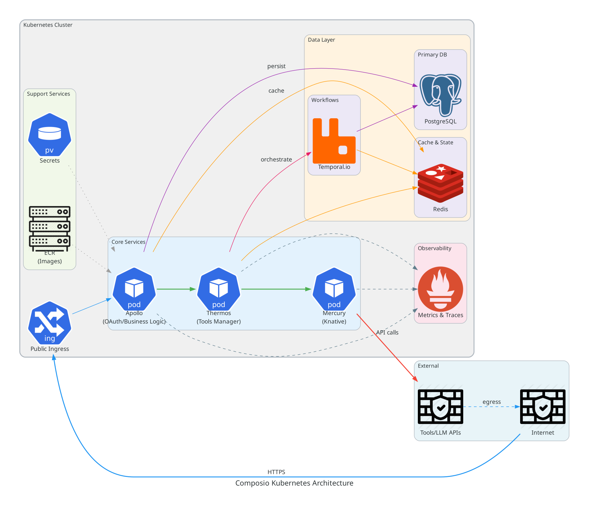

[](https://helm.sh/)
[](https://composiohq.github.io/helm-charts/index.html)

# Composio Helm Charts

Visit the Composio Enterprise portal to get your Helm chart:  

[Enterprise Installation](https://enterprise.composio.io/composio-rodent)
[Replicated migration guide](https://github.com/ComposioHQ/helm-charts/blob/release-stable/docs/migrate-to-replicated/README.md)


## Architecture 




# Configuration Guide

1. **OpenTelemetry (OTEL) Configuration** - Configure OpenTelemetry for observability and monitoring. [View Guide](https://github.com/ComposioHQ/helm-charts/blob/release-stable/docs/post-installation/index.md#opentelemetry-otel-configuration)

2. **Datadog Alerts Setup** - Set up alerts and monitoring using Datadog. [View Guide](https://github.com/ComposioHQ/helm-charts/blob/release-stable/docs/monitoring/alerts/datadog.md)

3. **Object Store Configuration**
   - **Azure Blob Storage** - Configure Azure Blob Storage for Apollo. [View Guide](https://github.com/ComposioHQ/helm-charts/blob/release-stable/docs/azure-blob-storage.md)
   - **S3 Storage** - Configure S3-compatible storage (AWS S3, GCP GCS) for Apollo. [View Guide](https://github.com/ComposioHQ/helm-charts/blob/release-stable/docs/gcs-s3-storage.md#configuring-s3-and-gcs-for-file-storage)

4. **Frontend Configuration**
   - **Composio Frontend** - Configure the Composio frontend. [View Guide](https://github.com/ComposioHQ/helm-charts/blob/release-stable/docs/frontend-setup.md)
   - **SMTP Setup** - Configure SMTP for email functionality. [View Guide](https://github.com/ComposioHQ/helm-charts/blob/release-stable/docs/smtp-setup.md)


## Managed VPC image releases

`composio/values-managed-vpc.yaml` configures external dependencies, workload IAM,
prepared secrets/service accounts, database TLS and Fargate-compatible resources.
Merge public customer settings and immutable application image references over it.
The deployment runner supplies actual resource references and secret values.

Package a single release with its already tested runner image:

```bash
node scripts/package-replicated-release.mjs \
  --version 0.2.14-managed-vpc-test.2 \
  --runner-publication /path/to/publication.json \
  --chart-reference oci://registry.replicated.com/composio-rodent/managed-vpc-test/composio \
  --values /path/to/public-managed-vpc-values.yaml \
  --qualification /path/to/qualification.json \
  --output /path/to/new-release-directory
```

The publication record must declare runner contract version 2 and the embedded
infrastructure hash. The generated chart and release lock bind the runner image,
source revision, infrastructure, chart content and application image digests.
There is no separate infrastructure chart or archive download. The bootstrap
package is included as a local companion. Packaging never pushes or deploys.
Without explicit qualification, output is a candidate rather than a deployment
lock. Qualification must describe the integrations and features actually tested.
Keep customer licenses, personalized chart archives and credential values outside
Git. The customer initializes its S3/KMS Pulumi stack once, reviews a real preview,
and approves the same pinned release before infrastructure and Helm deployment.

For Janus-managed Nightly publication, STS testing and approval-gated Stable
promotion, see the [nightly executor configuration](scripts/README.md#janus-nightly-executor).
